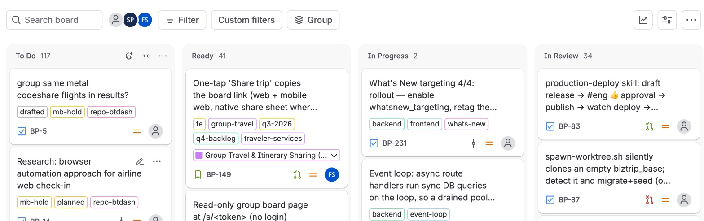
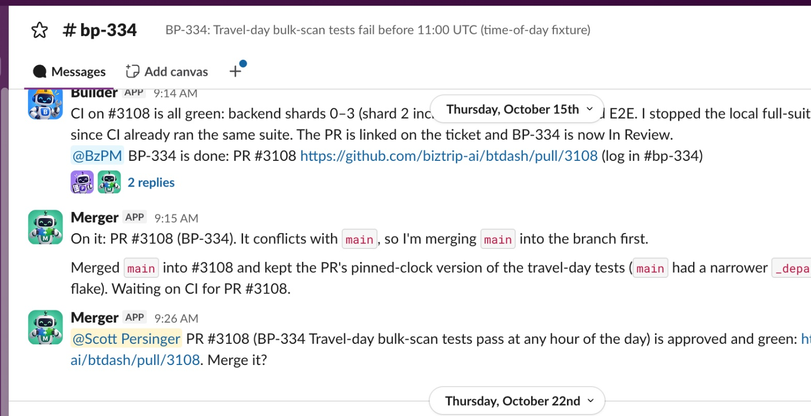
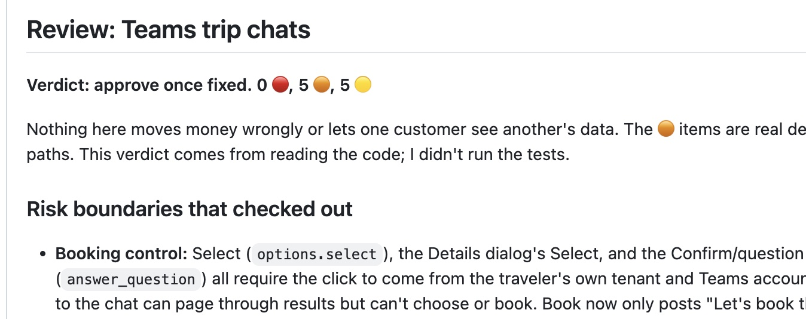

The Biztrip team entered 2026 with most people using Cursor or Claude as their local coding agent. By February we had adopted a _cloud agent_ running Claude, linked into our Slack workspace. By teaching Claude how to run and test our app, we were able to move to 80% AI code reviews.

At this point we could have our cloud agent build "small tickets" and push its own PRs, but this only worked well for simple changes.

By August I was setting up our real _software factory_ for the team. After some [experimentation](https://scottpersinger.com/blog/posts/2026-08-24-building-your-software-factory.html), we settled on this _agent team_:

* BzPM - our _product manager_ agent, running Claude with Fable, and skills and instructions for both spec'ing new work, creating JIRA tickets, and managing the other agents of the team.
* Builder - our primary _building_ agent, running Opus 5. Has skills and guardrails for both constructing new code, and testing and validating new features and bug fixes.
* Merger - our agent dedicated just to _merging_ PRs. Using this agent offloads merge and conflict resolution from the _Builder_ so we don't bottleneck on merges (since writing the code for tickets is the long pole).
* Omni - This agent reviews operational signals, Sentry reports, user feedback, and agent traces, to detect issues found in production. When issues are found it creates JIRA tickets which can then get picked up by the other agents of the factory.

Each agent relies on a `PROTOCOL.md` file which give it its instructions and explains its role in the factory. _BzPM_ acts as the coordinator driving Builder and Merger. The protocol also describes how _JIRA tickets_ should transition status states:

## Communication

All our agents are linked into our _Slack workspace_, and they communicate with each other in Slack channels just like other members of the team. Having visibility in Slack allows us to monitor each agent and supervise their interactions with each other.

In addition all work status is tracked in JIRA. The combination allows us to monitor the state of each _ticket_, while debugging issues in detail within the Slack conversation.

Besides text, agents are able to share screenshots and recordings into Slack to help us verify their work. Our protocol instructs the PM to create a new Slack channel dedicated to the work on each JIRA ticket: 

This gives us a simple, human-friendly model for tracking all ticket progress, debugging the work as it progresses.

## PR Review
PRs created by the factory are reviewed twice: once by the _Builder_ after it completes work on a ticket, and a second time by the _PM_ agent. The adversarial review performs both static code analysis, and examines if the Builder provided evidence that the task was completely properly. 

the review protocol defines 'high', 'medium', and 'low' urgency issues and these are color coded into the review comment. The color coding helps us humans on the team quickly assess the state of a PR. Our protocol indicates that _High_ items MUST be fixed, _Medium_ issues are recommended to fix but don't block the PR. 

This adversarial review system means that many PRs are fixed/improved autonomously before merging, and people on the team can easily review the history of any PR.

### Required human-in-the-loop
Any PRs which touch security sensitive code (RBAC, SSO, authentication, ...) are labeled as requiring human review. These PRs can receive positive commentary from an agent, but a human is required to manually approve the PR before it can be merged.

## Positive results
All engineers use the software factory, and our product managers are now able to build entire features independently using just the factory. We spend less time monitoring system performance reliability and since we have agentic loops setup to help us.

We still do manual code review for large architecture and data model changes, but more of our _manual time_ now goes to improving the performance of the software factory itself via improved _skills_, tools and guardrails.

Critically, every developer and PM understands the product features we are building and is able to execute features streams with much greater autonomy as a result of operating at a much higher level of abstraction.

Since standardizing on our software factory, measured PR delivery velocity has improved by 2.5x. This improvement took 4 months. Our prior evolution from _AI code completion_ --> _AI code review_ also generated a 2.5x velocity improvement, but took us 10 months. Overall the Biztrip team has improved delivery velocity by 6x since we started in April 2025, without significantly growing team headcount.

## What's next
The software factory tooling still leaves much to be desired. We have home-grown many of the components, and we designed around our existing human-centric JIRA/Github/Slack workflow. The result still requires too much context switching between tools to manage our work at different levels of detail.

Identity and attribution are still sore points, as our agents are not fully represented as autonomous principals in our tools like Slack and Github. Work attribution ("agent X did this work at the behest of user Y") can still be fuzzy and isn't recorded as systematically as we would like.

And the factory itself doesn't always run perfectly - it is possible to get two agents working on the same ticket, although two _people_ filing tickets for the same issue is even more common! 

We are also continuing to find better ways to integrate unit / integration / acceptance / eval testing into an effective testing regime that is still time and token efficient.